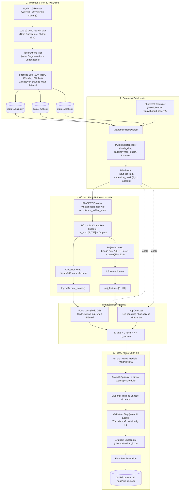

# Sơ đồ Luồng Dữ liệu & Kiến trúc Hệ thống (Data Flow & System Architecture)

Tài liệu mô tả luồng xử lý dữ liệu và pipeline huấn luyện cho dự án **"Enhancing Minority-Class F1 in Text Classification via Joint Focal-Contrastive Representation Loss"** sử dụng backbone PhoBERT.

---

## 1. Sơ đồ Luồng Dữ liệu Tổng thể (End-to-End Data Pipeline)

---

## 2. Chi tiết Từng Giai đoạn trong Luồng Dữ liệu

### Giai đoạn 1: Chuẩn bị & Chia dữ liệu
- **Đầu vào:** Dataset từ HuggingFace (`tarudesu/ViCTSD` hoặc `uitnlp/vietnamese_students_feedback`) hoặc bộ `dummy data`.
- **Chống rò rỉ (Data Leakage Protection):** Gộp toàn bộ các split có sẵn, loại bỏ văn bản trùng lặp (`drop_duplicates(subset=['text'])`) trước khi phân chia.
- **Tách từ (Word Segmentation):** Sử dụng thư viện `underthesea` với chế độ `format="text"` (ghép từ phức bằng dấu gạch dưới `_`, phù hợp với tokenizer của PhoBERT).
- **Phân tầng (Stratified Split):** Chia tập dữ liệu theo tỷ lệ **80% Train / 10% Val / 10% Test** có `stratify=labels`, đảm bảo tỷ lệ lớp thiểu số đồng nhất giữa các tập.

### Giai đoạn 2: DataLoader & Mã hóa
- **Tokenizer:** `vinai/phobert-base-v2`.
- **Đóng gói Tensor:**
  - `input_ids`: Tensor kích thước `[batch_size, max_length]`.
  - `attention_mask`: Tensor nhị phân kích thước `[batch_size, max_length]`.
  - `label`: Tensor `[batch_size]`.

### Giai đoạn 3 & 4: Forward Pass & Hàm Mất mát Kết hợp
- Biểu diễn của câu được lấy từ token `[CLS]` (vector 768 chiều).
- **Nhánh phân loại (Classifier Branch):** Chiếu qua `nn.Linear(768, num_classes)` tạo ra `logits` cho `FocalLoss`.
- **Nhánh tương phản (Contrastive Branch):** Chiếu qua `Projection Head` (MLP 2 lớp) thành vector 128 chiều và chuẩn hóa $L_2$ (`proj_features`), đưa vào `SupConLoss`.
- **Hàm mất mát toàn phần (Joint Objective):**
  $$\mathcal{L}_{total} = \mathcal{L}_{Focal} + \lambda_{supcon} \cdot \mathcal{L}_{SupCon}$$

### Giai đoạn 5: Đánh giá & Lưu trữ
- Tiêu chí lựa chọn checkpoint tốt nhất là **Macro-F1** trên tập Validation.
- Ghi log đầy đủ metrics: `accuracy`, `macro_f1`, `minority_precision`, `minority_recall`, `minority_f1` cho từng epoch và tập test vào file `.json`.
